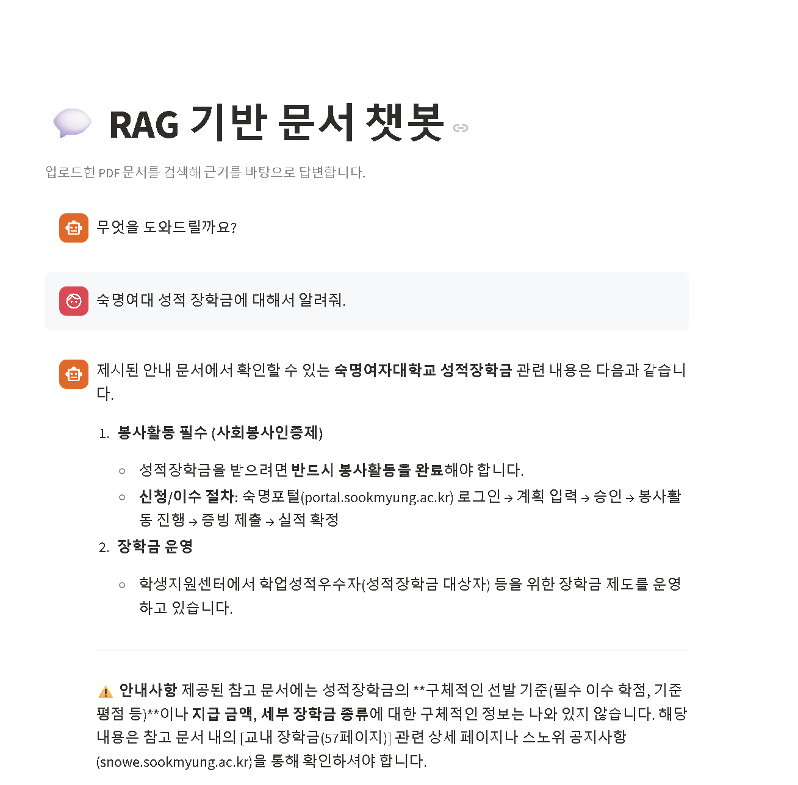
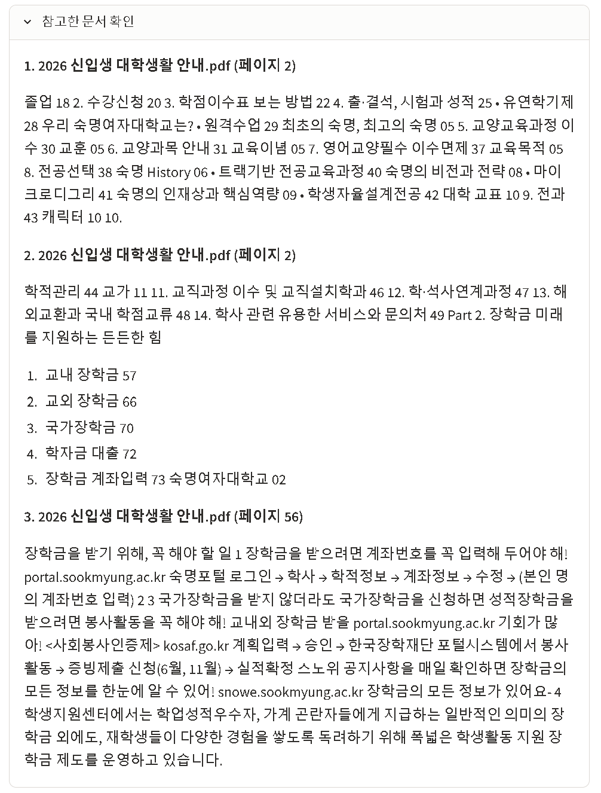
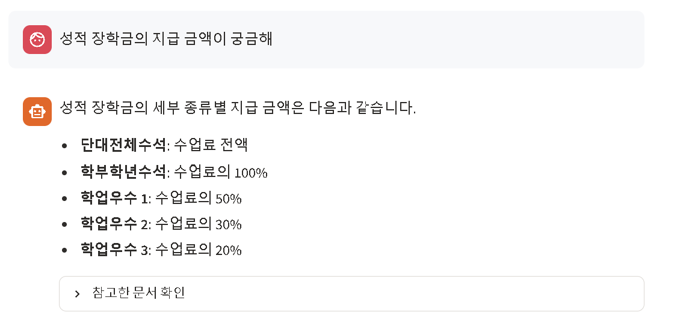
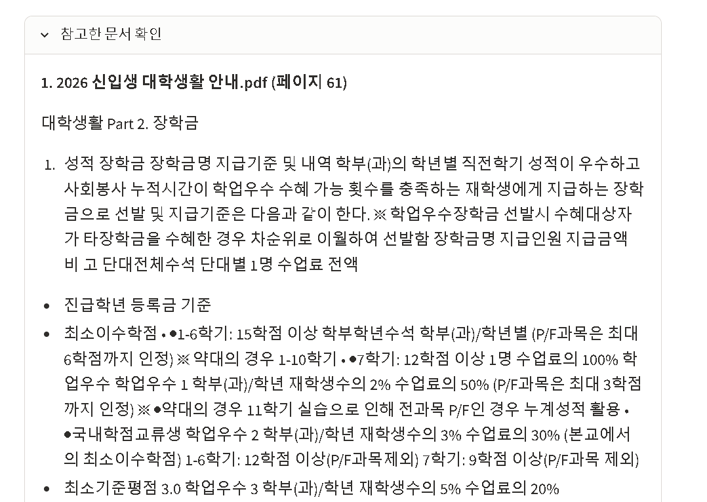

### RAG 기반 챗봇

- RAG 등장 이전 : 시나리오 기반 챗봇
    - 미리 정의된 시나리오와 규칙에 따라 답변
    - 복합 질문 처리 한계 (2가지 이상의 질문을 하면 한개의 질문에 대한 답변은 누락됨..)
    - 시나리오에 포함되지 않은 정보에 대한 응답이 어려움
- RAG 기반 챗봇
    - LLM이 외부 데이터베이스(Vector DB)에 저장된 문서를 검색하여 답변 생성
    - 사용자의 질문과 관련된 정보를 검색하므로 복합적인 질문에도 유연하게 대응 가능
    - 검색한 문서를 근거로 답변을 생성하고, 출처를 함께 제시할 수 있음

### RAG (Retrieval-Augmented Generation : 검색-증강 생성)

- **비파라메트릭 메모리**
    - 모델 외부에 존재하는 벡터 스토어, DB 등
    - **Retriever**
        - 사용자 질과 관련된 비파라메트릭 메모리(외부 저장소)에서 관련 문서를 찾아 프롬프트에 제공
- **파라메트릭 메모리**
    - LLM의 사전 학습(Pre-training) 과정에서 모델 파라미터에 내재된 지식
    - 언어 규칙, 문맥 이해력, 일반적인 세계 지식 등
    - **Generator**
        - 외부 검색 없이 모델 내부 연산 + Retriver가 가져온 외부 문맥 → 답변 생성

### Amazon Bedrock (참고)

- AWS에서 제공하는 생성형 AI 애플리케이션 구축 및 배포를 위한 완전 관리형 서버리스 서비스
- RAG 구현에 필수는 아니지만, 다음과 같은 장점 존재
    - 단일 API로 다양한 모델 활용 가능
    - 별도의 AI 인프라나 서버, GPU 클러스터를 직접 구축, 관리할 필요 없음
    - AWS의 보안 기능과 연동 가능, 암호화 기능 제공
    - RAG 구축 기능 제공 : **Knowledge Bases**
        - 데이터 소스 연결 : Amazon S3  등과 연결 가능
        - 데이터 처리 : 문서 파싱, 청킹, 임베딩 수행
        - 벡터 저장 : 임베딩 벡터와 관련 데이터를 벡터 스토어에 저장
        - 검색 : 사용자 질문과 관련된 문서 청크 검색
        - 답변 생성 : 검색된 문맥을 기반으로 LLM이 답변 생성
- 이번에는 Amazon Bedrock을 사용하지 않고 LangChain을 활용하여 RAG의 각 단계를 직접 구성
    - Gemini API LLM 모델  + HuggingFace 임베딩 모델 + ChromaDB 연결
    - 추후 Amazon Bedrock의 모델 호출 API 또는 Knowledge Bases 활용 방식으로 확장 가능

### RAG 챗봇 구조

1. **데이터 수집 및 적재**
    - PDF 문서를 `pdfs/` 폴더에 저장
    - PyMuPDF와 pdfplumber를 이용하여 PDF에서 텍스트 추출
        - PyMuPDF
        - pdfplumber
2. **문서 분할 (Chunking)**
    - 추출한 텍스트를 여러 개의 작은 텍스트 덩어리(Chunk)로 분할
    - 문서의 의미와 문맥을 고려하여 분할하는 Semantic Chunking 방식 사용
        - LangChain SemanticChunker
3. **임베딩 및 벡터 저장**
    - 분할된 문서 청크를 임베딩 모델을 통해 벡터로 변환
        - HuggingFace `jhgan/ko-sroberta-nli`
    - 변환된 임베딩 벡터와 원본 텍스트를 ChromaDB에 저장 (= 비파라메트릭 메모리)
        - ChromaDB
            - AI 및 LLM 개발을 위해 설계된 오픈소스 vector DB
            - LangChain 연동이 쉽고, semantic search (의미 기반의 유사도 검색) 빠르게 수행
4. **Retrieval (검색)**
    - 사용자 질문 입력 → 임베딩
    - 질문 벡터와 문서 벡터간의 유사도를 비교해 관련 문서 청크 검색 (= Retriever)
        - ChromaDB Retriever (검색 결과 상위 3개 문서)
5. **Augmentation & Generation (증강 및 생성 단계)**
    - 검색된 문맥 (문서 청크) + 사용자 질문 → 프롬프트
        - 문맥 = 비파라메트릭 메모리 / LLM 모델의 사전 지식 = 파라메트릭 메모리
    - 결합한 프롬프트를 LLM 모델(= Generator)에 전달해 답변 생성
        - Google Gemini API (gemini 3.5 flash)
6. Streamlit을 이용하여 웹 기반 챗봇 인터페이스 구현

### 챗봇 실행

1. 가상환경 생성
    
    ```bash
    python -m venv .venv
    .venv\Scripts\Activate.ps1
    ```
    
2. 패키지 설치
    
    ```bash
    pip install -r requirements.txt
    ```
    
3. `.env` 파일에 Gemini API 키 설정
4. `pdfs/` 폴더에 검색할 PDF 넣기
5. 벡터 DB 생성
    
    ```bash
    python build_db.py
    ```
    
6. 챗봇 실행
    
    ```bash
    streamlit run app.py
    ```
    

### 실행 결과
- 숙명여대 성적 장학금에 대해서 알려줘    
     
    

- 성적 장학금의 지급 금액이 궁금해    
    - 질문을 구체적으로 작성할수록 관련 정보를 더 정확하게 검색해, 완성도 높은 답변을 얻을 수 있음.    
    
    